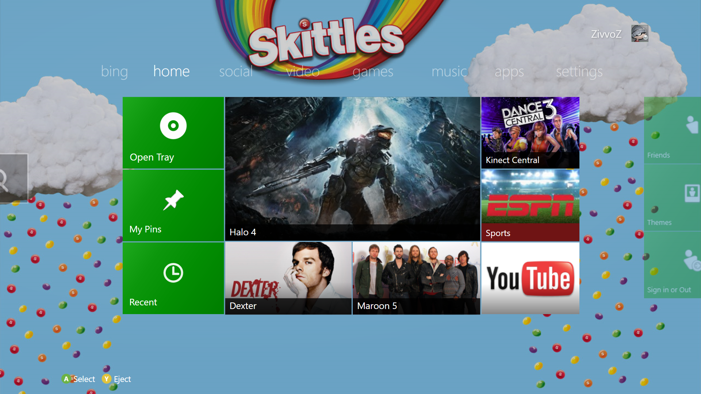
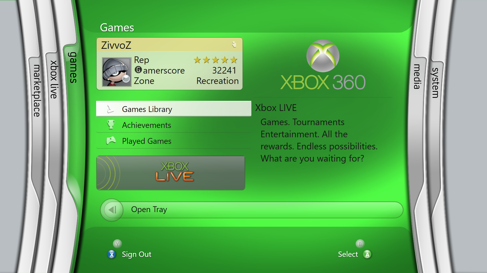

# DashX360 — Xbox 360 Metro & Blades Dashboards for Windows

**The first fan-made recreation of the Xbox 360 Metro Dashboard experience for Windows — now featuring both Metro and Blades dashboards.**

https://youtube.com/@zivvoz

## DashX360 v1.3.0 — Blades Update

### What's New

* Added the new **Xbox 360 Blades-style dashboard**
* Marketplace, Xbox Live, Games, Media, and System blades
* Blades opening, closing, and navigation animations
* Added a **Blades-style Xbox Guide** based on the original dashboard 
* Controller navigation throughout the Blades interface
* Integrated Blades alongside the existing Metro Dashboard
* Various interface refinements throughout DashX360
* General performance, stability, and quality-of-life improvements

The Blades recreation is still being improved, and some animations and smaller visual details may change in future versions.

## Features

- Xbox 360-inspired Metro dashboard tabs for games, apps, music, video, social, Bing, and settings
- Xbox 360-inspired Blades dashboard tabs for marketplace, xbox live, games, media and system
- Controller-first navigation with keyboard and mouse support
- Xbox Guide overlay with Friends, Party, Profile, media controls, achievements, and search screens
- Swap between blades and metro style, guide, sounds and startup to make your OWN personal dashboard
- Local profile and friend data with cached gamer pictures
- Boot video, dashboard audio cues, and Metro-style tile presentation
- Custom theme support
- Steam library scanning with Steam-provided cover art
- Import/export support for user data transfer and version updates

## How to Use
1. Launch the application.
2. Connect your controller.
3. In Steam, turn off Enable Guide Button Chords for controllers.
4. Use the Back + Start buttons together (or Win + Left Shift + Left Ctrl) to open the Guide.
5. Navigate with the controller just like the original Xbox 360 dashboard.

### Requirements

- Untick `Enable Guide Button Chords for controllers` to use the guide if using steam
- Windows 10 or Windows 11

### Working on the Project

DashX360 is open for people who want to help improve it. If you use this project, modify it, or build on top of it, please credit Xbox/Microsoft, the project and the project's creator:

Original project by zivvoz / DashX360 - inspired by Microsoft's Xbox 360 Dashboard's interfaces.

## Controls

- `A` / `Enter`: select
- `B` / `Escape`: back
- `X`: context actions where available
- `Y`: secondary actions where available
- Win + Ctrl + Shift / Back + Start : open the Xbox Guide overlay

## Legal / Disclaimer

DashX360 is an independent, unoffical fan-made software project developed for my own personal and historic interest. It recreates aspects of the Xbox 360 Dashboard experience on Windows and is not devloped, operated, authorized, endorsed, or sponsored by Microsoft or Xbox. DashX360 is not an official Xbox product, service, emulator, or replacement for Microsoft's software or online services. It does not provide access to official Xbox LIVE services. The project is provided free of charge and is not intended to imply ownership of, or claim rights to Microsoft's copyrighted material.

DashX360 incorporates some original Xbox 360 assets, including sounds and graphical elements obtained from the Xbox 360. These materials remain the property of their respective rights holders. Their inclusion does not imply authorization, endorsement, or affiliation with Microsoft or Xbox.

Xbox, Xbox 360, Xbox Live, Microsoft and their trademarks, names, logos, and other copyrighted material belong to their respective owners. All rights remain with their respective owners. The DashX360 name and original code are not intended to imply any affiliation with Microsoft or Xbox.
